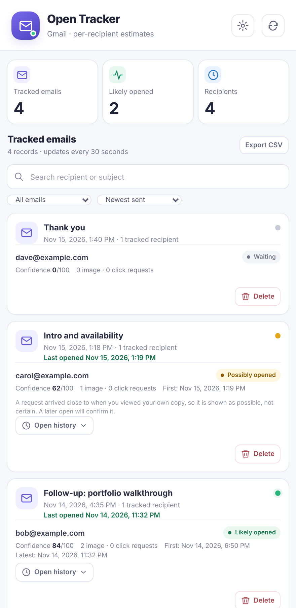
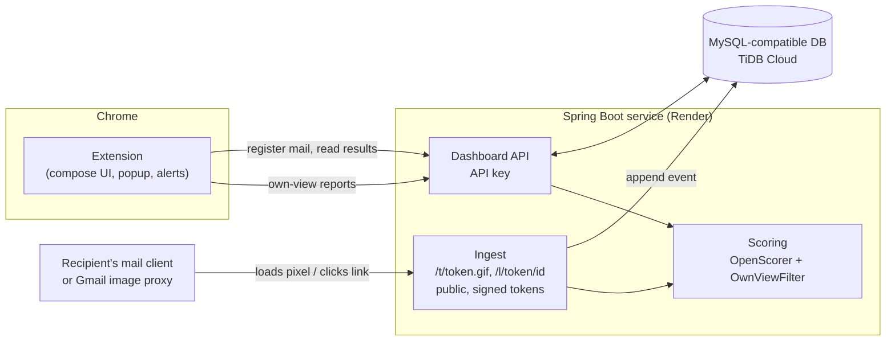
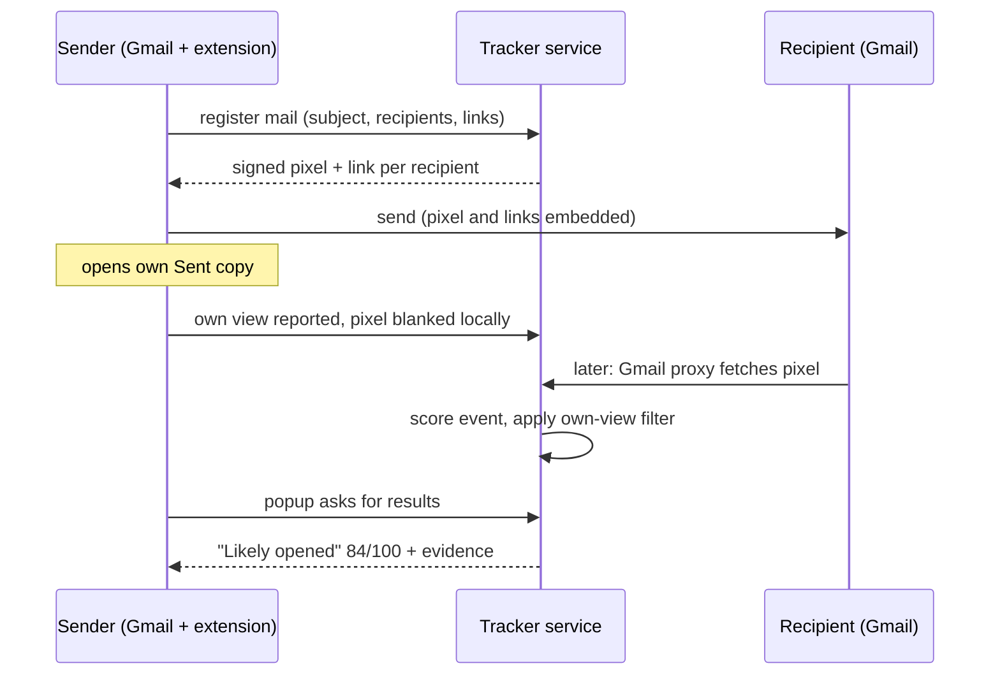

# Gmail Open Tracker

A Chrome extension and a Spring Boot service that estimate, **per recipient**, whether an email you chose to track was
opened or a link was clicked, and say how sure they are. It is an estimate, never proof: no tracking pixel can see a
person. Built to be honest about that: scanners, Apple's image prefetch and *your own* views are filtered out, and the
popup shows the evidence behind every verdict.

| Dashboard | Open history for one recipient |
|---|---|
|  |  |

*Screenshots use made-up data (example.com addresses).*

## Features

- **Per-recipient tracking.** Each recipient gets their own signed pixel and links. Several recipients can get separate
  tracked copies (optional Google sign-in), so you see who opened, not just that someone did.
- **Gmail-native.** A **Track opens** checkbox sits beside Send in the compose window; link clicks can be tracked too.
- **Accuracy work, not just a pixel.** Requests are scored by who fetched them, timing, IP ranges (Google, Apple) and
  repetition. Your own views of a Sent copy are blocked and filtered; opens near them are capped at "possibly".
- **Evidence you can read.** Every verdict lists why, including a timeline of separate opens and all raw requests.
- **Alerts.** Desktop notification plus an optional email (via EmailJS) the first time someone opens or clicks.
- **Dashboard tools.** Search, filter, sort, last-opened, CSV export, and a badge for new opens.
- **Free to run.** Deploys on Render + TiDB Cloud with no card. See [`docs/OPERATIONS.md`](docs/OPERATIONS.md).

## Architecture



1. **Per-recipient tokens.** Each recipient gets HMAC-signed pixel and link URLs (`core/TokenSigner`). The ingest side
   verifies the signature without touching the database, then appends one event (derived facts only: no IP address, no
   User-Agent stored). Bad tokens still get the image and links still redirect, so a recipient never sees an error.
2. **Verdicts are recomputed from raw events on every read**, so tuning the scorer re-scores history.
3. **Own views.** The extension blanks the pixel in the sender's own Sent copy and reports the view. The server ignores
   requests within seconds of it and caps any slightly further away at "possibly opened".



## How scoring works

Each request becomes a 0 to 100 score on its own, then the scores for one recipient are combined.

| Request | Score |
|---|---|
| `HEAD` request, or a scanner/bot User-Agent | 2 to 5 (ignored in practice) |
| Pixel fetched under 30 s after sending (compose preview, your view, delivery scan) | base 8 |
| Pixel fetched 30 s to 5 min after sending | base 50 |
| Pixel fetched over 5 min after sending | base 72 |
| ...by Gmail's image proxy from a Google address | base + 12 (+ 8 if the address list is unavailable; capped at 30 if it claims to be Gmail but isn't a Google address) |
| ...from Apple's relay (Mail Privacy Protection) | at most 10: Apple loads images for the user |
| Link click under 30 s after sending | 20 (likely a link scanner) |
| Link click later | 92 |

Combining: requests under 2 s apart count as one fetch. Groups scoring under 15 are noise and add nothing. The rest are
combined as independent evidence, `1 - Π(1 - score/100)`. Two credible opens at least an hour apart lift the result to
at least 90 ("a person re-reading"). A real click makes it `ENGAGED`.

| Verdict | Meaning |
|---|---|
| `ENGAGED` | a link was clicked by something that looks human |
| `OPENED` ("Likely opened") | combined score 70 or more |
| `POSSIBLY_OPENED` | 35 to 69, including opens close to your own view |
| `AUTOMATED_ONLY` | requests seen, all look automated |
| `NO_ACTIVITY` ("Waiting") | nothing received |

All thresholds live in `core/ScoringConfig` and `application.yml` (`tracker.scoring.*`). They are starting heuristics:
[`calibration/CALIBRATION.md`](calibration/CALIBRATION.md) describes how to measure and tune them against your own test
mail, with a script that reports recall, precision and mistakes per mail client.

## Limits you cannot engineer away

- Recipients who block images are invisible. Absence of an open is not proof the mail was unread.
- Apple Mail Privacy Protection hides real opens (reported as "not measurable"; only clicks help).
- Gmail's proxy looks the same for you and the recipient, so an open within about 20 s of your own view is dropped.
- One shared copy cannot say which person opened. Separate copies can (no inline images, replies or forwards;
  attachments up to 5 MB in total).
- Forwarded mail reuses the original URLs. Scheduled sends look "late" to the timing check.

More detail: [`REVIEW.md`](REVIEW.md). Use this only on email where you have a lawful basis, and respect your
organisation's policy and recipients' privacy.

## Tech stack

| Part | Tech |
|---|---|
| Extension | Chrome Manifest V3, React 19 + Vite (popup), plain JS content/background scripts, Gmail API for separate copies |
| Backend | Java 17, Spring Boot 3.5, Spring Data JPA, HikariCP |
| Database | MySQL 8 locally (Docker); TiDB Cloud Starter in production |
| Tests | JUnit 5 (unit + full-flow integration on H2), Node test runner + jsdom for the extension |
| Deploy | Docker multi-stage image, Render, UptimeRobot, optional Caddy/Azure files in `deploy/` |

## Run locally

```bash
docker compose up -d                          # MySQL
cd backend && mvn spring-boot:run             # mode=all on :8080 with development secrets
cd extension && npm install && npm run build  # then chrome://extensions > Load unpacked > extension/dist
```

Locally the pixel points at `http://localhost:8080`, which **no recipient can reach**, so you only see your own test
traffic. Deploy it for real use.

## Deploy and operate

1. [`deploy/DEPLOY_FREE.md`](deploy/DEPLOY_FREE.md): Render + TiDB Cloud + UptimeRobot, no card.
2. [`docs/OPERATIONS.md`](docs/OPERATIONS.md): database settings for TiDB, data export, secret rotation, monitoring.
3. Extension **Settings**: API URL and key, send mode, link tracking, desktop and email alerts.
4. Optional: [`extension/GOOGLE_SETUP.md`](extension/GOOGLE_SETUP.md) for separate per-recipient copies.
5. Other hosting: [`deploy/DEPLOY.md`](deploy/DEPLOY.md) (own server) and [`deploy/DEPLOY_AZURE.md`](deploy/DEPLOY_AZURE.md).

## Configuration (environment)

| Variable | Meaning |
|---|---|
| `TRACKER_MODE` | `ingest`, `api` or `all` |
| `TRACKER_PUBLIC_BASE_URL` | Public https address embedded in emails. Keep it stable forever |
| `TRACKER_SIGNING_SECRETS` | Comma-separated, first signs, all verify (rotation) |
| `TRACKER_API_KEY` | Dashboard API key |
| `TRACKER_STRICT` | `true` = refuse to start with weak or default settings |
| `TRACKER_CLIENT_IP_HEADER` | `X-Forwarded-For`, `X-Forwarded-For:first`, `CF-Connecting-IP` or `remote` |
| `TRACKER_RATE_LIMIT_BURST` / `_PER_SECOND` | Per-address limit on the public endpoints |
| `DB_URL` / `DB_USERNAME` / `DB_PASSWORD` / `DDL_AUTO` | Database |
| `tracker.scoring.*` | Scoring thresholds (see `application.yml`) |

## Tests

- Backend: `cd backend && mvn clean test`
- Extension: `cd extension && npm test`

## Project layout

```
backend/      Spring Boot service: ingest/ (public), api/ (dashboard), core/ (scoring, tokens), model/, repo/
extension/    Chrome extension: public/ (manifest, content/background scripts), src/ (React popup), test/
calibration/  Script and protocol for measuring accuracy against ground truth
deploy/       Dockerfiles, compose files, hosting guides, data-export script
docs/         Operations guide and screenshots
```
