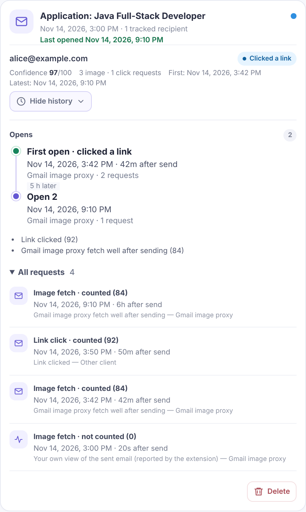
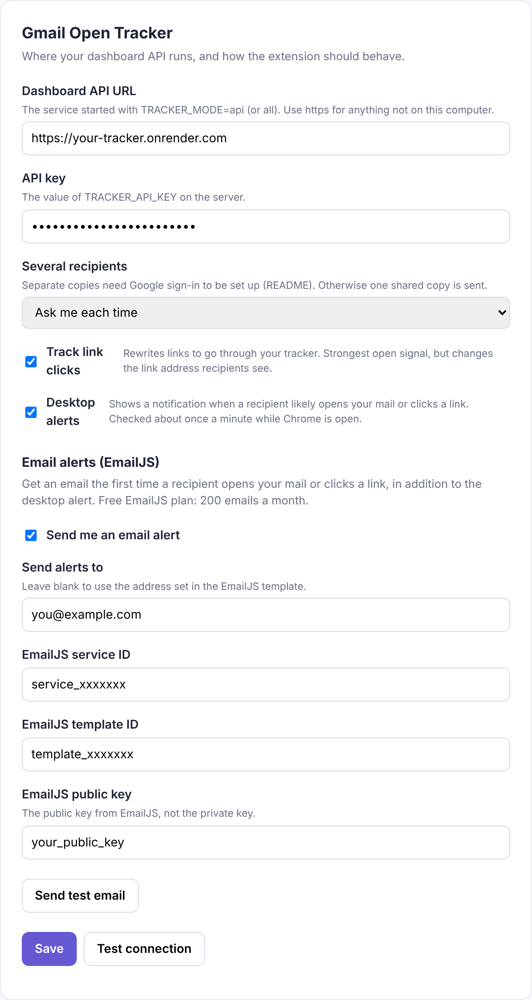
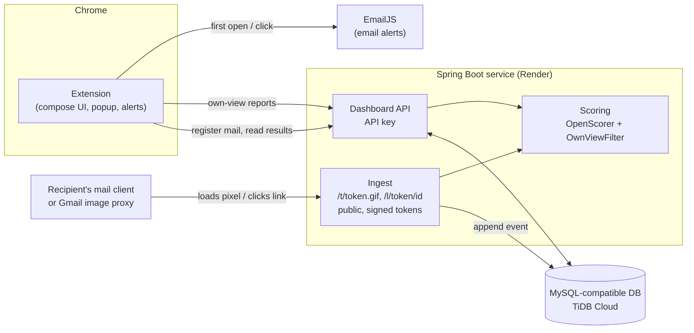
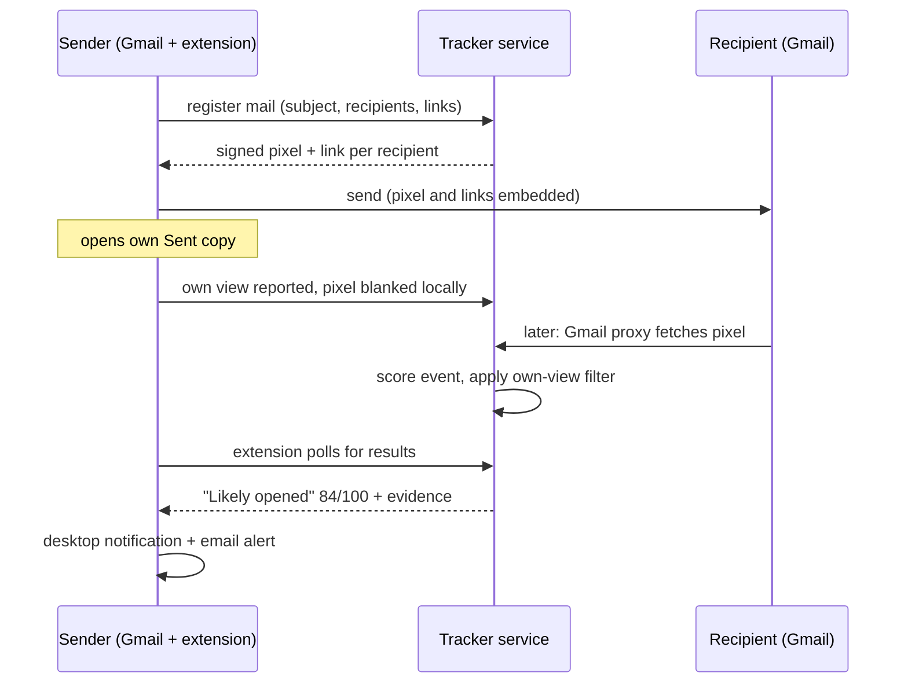

<div align="center">


# 📬 Gmail Open Tracker

**Know who opened your email, and how sure we are.**

Chrome Extension · Spring Boot · React · MySQL / TiDB

[](../../releases)
[](LICENSE)
[](backend)
[](backend)
[](extension)
[](extension)
[](docs/OPERATIONS.md)
[](#-tests)

</div>

---

## What it does

Gmail Open Tracker estimates, **per recipient**, whether an email you chose to track was opened or a link was clicked,
and tells you how confident it is. It has two parts that work together:

1. **A Chrome extension** that adds a **Track opens** checkbox beside Gmail's Send button, shows a dashboard in the
   toolbar popup, and alerts you the moment someone opens your mail.
2. **A Spring Boot service** that serves the tracking pixel and link redirects, scores every request, and stores the
   evidence.

It is an **estimate, never proof**: no tracking pixel can see a person. The project is built to be honest about that.
Scanners, Apple's image prefetch and *your own* views are filtered out, and every verdict shows the evidence behind it.

## Screenshots

<table>
<tr>
<td width="50%">

**Dashboard**


</td>
<td width="50%">

**Open history for one recipient**


</td>
</tr>
<tr>
<td colspan="2">

**Settings page** (API, sending mode, link tracking, desktop and email alerts)
<div align="center"></div>

</td>
</tr>
</table>

*Screenshots use made-up data (example.com addresses and placeholder keys).*

## ✨ Features

### 📨 Sending and tracking (in Gmail)

| Feature | Details |
|---|---|
| **Track opens checkbox** | Sits beside Send, so it is always visible. Also works with Ctrl/Cmd+Enter. |
| **Per-recipient tracking** | Every recipient gets their own signed pixel and link URLs. |
| **Several recipients, your choice** | Settings: *ask me each time*, *always separate copies*, or *always one shared copy*. |
| **Separate tracked copies** | Each recipient gets their own message (they do not see each other), so you can tell who opened. Uses the Gmail API with optional Google sign-in. |
| **Attachments in separate copies** | Files are read from the compose window and attached to every copy (up to 5 MB in total). |
| **Safe fallbacks** | Replies, forwards, inline images, oversized or unreadable attachments automatically fall back to one shared copy, with an explanation. |
| **Link click tracking** | Optional. Rewrites links to pass through your tracker. Clicks are the strongest signal. |
| **Retry-safe sending** | Registration is idempotent: a timeout and retry never creates duplicate records. |
| **Partial-failure handling** | If some separate copies fail, a retry sends only to the ones that failed. |
| **Clear errors** | If the extension was reloaded, the Gmail tab says to refresh instead of failing silently. |

### 🎯 Accuracy

| Feature | Details |
|---|---|
| **Scoring, not a binary pixel** | Each request gets a 0 to 100 score from who fetched it, timing, IP range and kind of request. |
| **Scanner and bot filtering** | `HEAD` checks and scanner User-Agents are scored as noise. |
| **Gmail image proxy awareness** | Recognises Gmail's proxy and checks the address against Google's published ranges; spoofed claims are capped. |
| **Apple Mail Privacy Protection** | Apple's prefetch is scored down, and recipients who can't be measured are flagged "not measurable". |
| **Yahoo and Outlook clients** | Recognised and scored separately. |
| **Burst merging** | Requests under 2 seconds apart count as one fetch. |
| **Repeat-open detection** | Two credible opens at least an hour apart are read as a person coming back. |
| **Your own views excluded** | The extension blanks the pixel in your Sent copy, reports the view, and the server ignores requests right around it. Works only in the account that sent the mail, so a recipient account in the same browser still counts. |
| **Near-view downgrade** | Requests slightly further from your own view are not hidden: they count, but cap at "possibly opened". |
| **Verdicts recomputed on every read** | Raw events are append-only, so tuning the scorer re-scores all history. |
| **Calibration tools** | A protocol and script to measure recall, precision and mistakes per mail client against your own test mail. |

### 🖥️ Dashboard (extension popup)

| Feature | Details |
|---|---|
| **Stat tiles** | Tracked emails, likely opened, recipients. |
| **Five clear statuses** | Clicked a link, Likely opened, Possibly opened, Automated requests only, Waiting. |
| **Confidence and counts** | Score out of 100, image and click request counts, first and latest open time. |
| **Open history timeline** | Groups requests into separate opens with the gap between them ("5 h later"). |
| **Every request, explained** | Full list with each request's score, source and the reason it was counted or ignored. |
| **Search and filter** | Search by recipient or subject; filter all, likely opened, any request, no requests. |
| **Sort** | Newest, oldest, recently opened, highest confidence. |
| **Last-opened line** | Shown on each card at a glance. |
| **CSV export** | Downloads every email matching your current search and filter. |
| **Shared-copy view** | Shows "Opened by someone" and lists the people, with an honest note that it can't say who. |
| **Delete** | Removes a tracked email and its whole history, with confirmation. |
| **Auto-refresh** | Every 30 seconds, plus a manual refresh button. Pagination at 25 per page. |

### 🔔 Alerts

| Feature | Details |
|---|---|
| **Desktop notification** | When a recipient likely opens your mail or clicks a link. Clicking it opens Gmail. |
| **Email alert (EmailJS)** | The same event by email, to the address you choose, so you see opens on your phone. |
| **Unseen-opens badge** | A count on the extension icon until you open the popup. |
| **No noise** | Alerts fire when evidence becomes strong, never for scanner traffic, and never flood on first run. |
| **Missed-while-offline catch-up** | If Chrome was closed, alerts are sent at next start. |
| **Test button** | "Send test email" checks your EmailJS setup from the Settings page. |

### ⚙️ Backend and API

| Feature | Details |
|---|---|
| **Three modes** | `ingest` (public pixel and links only), `api` (authenticated dashboard only), or `all`. |
| **Signed tokens** | HMAC-signed, verified without touching the database; supports secret rotation. |
| **Never breaks the email** | Bad or forged tokens still get the image, and links still redirect. |
| **Privacy by design** | Only derived facts are stored: no IP address and no User-Agent. |
| **Rate limiting** | Per source address on the public endpoints. |
| **Proxy-aware client IP** | Works behind Render, Caddy, nginx or Cloudflare (`X-Forwarded-For`, `X-Forwarded-For:first`, `CF-Connecting-IP`, `remote`). |
| **Self-updating IP lists** | Google and Apple address ranges are refreshed automatically. |
| **API key protection** | Every dashboard endpoint needs the key. |
| **Strict mode** | `TRACKER_STRICT=true` refuses to start with weak or default secrets or a non-public URL. |
| **Health endpoint** | `/api/health` for uptime monitors. |

### 🚀 Running it

| Feature | Details |
|---|---|
| **Free hosting** | Render + TiDB Cloud + UptimeRobot, no credit card. |
| **Docker** | Multi-stage image; Compose files for local MySQL and production. |
| **Other hosting** | Own server with Caddy, or Azure VM guide. |
| **Data export** | `deploy/backup.mjs` saves everything to a JSON file; Task Scheduler recipe included. |
| **Operations guide** | Database settings for TiDB, quotas, secret rotation, monitoring. |
| **Tested** | JUnit unit tests plus a full-flow integration test; 30 extension tests. |

## 🎛️ Extension settings

| Setting | What it does |
|---|---|
| **Dashboard API URL** | Where your tracker service runs (`https` required except for localhost). |
| **API key** | Matches `TRACKER_API_KEY` on the server. |
| **Several recipients** | Ask each time, always separate copies, or always one shared copy. |
| **Track link clicks** | Rewrites links so clicks are tracked. |
| **Desktop alerts** | Notification when a recipient likely opens or clicks. |
| **Email alerts** | Send-to address, EmailJS service ID, template ID and public key. |
| **Test connection / Send test email** | Verify the server and the alert email from the page. |

## Architecture





## How scoring works

Each request becomes a 0 to 100 score on its own, then the scores for one recipient are combined.

| Request | Score |
|---|---|
| `HEAD` request, or a scanner/bot User-Agent | 2 to 5 (ignored in practice) |
| Pixel fetched under 30 s after sending (compose preview, your view, delivery scan) | base 8 |
| Pixel fetched 30 s to 5 min after sending | base 50 |
| Pixel fetched over 5 min after sending | base 72 |
| ...by Gmail's image proxy from a Google address | base + 12 (+ 8 if the address list is unavailable; capped at 30 if it claims to be Gmail but isn't a Google address) |
| ...from Apple's relay (Mail Privacy Protection) | at most 10: Apple loads images for the user |
| Link click under 30 s after sending | 20 (likely a link scanner) |
| Link click later | 92 |

Combining: requests under 2 s apart count as one fetch. Groups scoring under 15 are noise and add nothing. The rest are
combined as independent evidence, `1 - Π(1 - score/100)`. Two credible opens at least an hour apart lift the result to
at least 90 ("a person re-reading"). A real click makes it `ENGAGED`.

| Verdict | Shown as | Meaning |
|---|---|---|
| `ENGAGED` | Clicked a link | a link was clicked by something that looks human |
| `OPENED` | Likely opened | combined score 70 or more |
| `POSSIBLY_OPENED` | Possibly opened | 35 to 69, including opens close to your own view |
| `AUTOMATED_ONLY` | Automated requests only | requests seen, all look automated |
| `NO_ACTIVITY` | Waiting | nothing received |

All thresholds live in `core/ScoringConfig` and `application.yml` (`tracker.scoring.*`). They are starting heuristics:
[`calibration/CALIBRATION.md`](calibration/CALIBRATION.md) explains how to measure and tune them against your own test mail.

## Project structure

| Folder | What it is |
|---|---|
| `backend` | Spring Boot service: `ingest/` (public), `api/` (dashboard), `core/` (scoring, tokens), `model/`, `repo/` |
| `extension` | Chrome extension (Manifest V3): `public/` (manifest, content and background scripts), `src/` (React popup), `test/` |
| `calibration` | Protocol and script for measuring accuracy against ground truth |
| `deploy` | Dockerfile support, compose files, hosting guides, data-export script |
| `docs` | Operations guide and screenshots |

## Live deployment

| Piece | Where | URL |
|---|---|---|
| Tracker service | Render (Docker, free tier) | `https://gmail-open-tracker-7e32.onrender.com` (`/api/health` is public; the dashboard API needs a key) |
| Database | TiDB Cloud Starter (MySQL-compatible) | private |
| Uptime monitor | UptimeRobot (5-minute ping) | keeps the free service awake |
| Extension | GitHub Releases | Download the latest `.zip` from [Releases](../../releases) |

> ⚠️ The service runs on Render's free tier, which sleeps after 15 idle minutes and takes about a minute to wake. The
> uptime monitor prevents that, but a free service can still restart without notice, and an open that arrives during a
> restart is lost.

## 🚀 Quick install (just want the extension?)

The extension is only a client: you need a tracker service of your own to point it at (see **Deploy your own copy**).

1. Download `gmail-open-tracker-extension-vX.X.X.zip` from the [Releases](../../releases) page
2. Unzip it
3. Go to `chrome://extensions` in Chrome
4. Turn on **Developer mode** (top-right toggle)
5. Click **Load unpacked** and select the unzipped folder
6. Open the extension **Settings**, enter your service URL and API key, and click **Test connection**
7. Compose an email in Gmail and tick **Track opens**

## 🛠️ Running it locally

```bash
docker compose up -d                          # MySQL
cd backend && mvn spring-boot:run             # mode=all with development secrets
cd extension && npm install && npm run build  # then chrome://extensions > Load unpacked > extension/dist
```

Locally the pixel points at `http://localhost:8080`, which **no recipient can reach**, so you only see your own test
traffic. Deploy it for real use.

## Deploying your own copy

| Piece | Platform | Notes |
|---|---|---|
| Service | [Render](https://render.com) | Web Service, Docker runtime, root directory `backend`. Set the environment variables below; never commit them. |
| Database | [TiDB Cloud](https://tidbcloud.com) Starter | Free MySQL-compatible database; see [`docs/OPERATIONS.md`](docs/OPERATIONS.md) for connection settings. |
| Keep-awake | [UptimeRobot](https://uptimerobot.com) | HTTP monitor on `/api/health` every 5 minutes. |
| Extension | GitHub Releases | Zip the built `extension/dist` and attach it; Chrome extensions install locally. |

Step by step: [`deploy/DEPLOY_FREE.md`](deploy/DEPLOY_FREE.md). Other options: [`deploy/DEPLOY.md`](deploy/DEPLOY.md)
(own server with Caddy) and [`deploy/DEPLOY_AZURE.md`](deploy/DEPLOY_AZURE.md). Separate per-recipient copies need your
own Google OAuth client: [`extension/GOOGLE_SETUP.md`](extension/GOOGLE_SETUP.md).

### Configuration (environment)

| Variable | Meaning |
|---|---|
| `TRACKER_MODE` | `ingest`, `api` or `all` |
| `TRACKER_PUBLIC_BASE_URL` | Public https address embedded in emails. Keep it stable forever |
| `TRACKER_SIGNING_SECRETS` | Comma-separated, first signs, all verify (rotation). At least 32 characters each |
| `TRACKER_API_KEY` | Dashboard API key. At least 20 characters |
| `TRACKER_STRICT` | `true` = refuse to start with weak or default settings |
| `TRACKER_CLIENT_IP_HEADER` | `X-Forwarded-For`, `X-Forwarded-For:first`, `CF-Connecting-IP` or `remote` |
| `TRACKER_RATE_BURST` / `TRACKER_RATE_PER_SECOND` | Per-address limit on the public endpoints |
| `TRACKER_IP_LISTS_ENABLED` | Refresh Google and Apple address ranges (default on) |
| `DB_URL` / `DB_USERNAME` / `DB_PASSWORD` / `DDL_AUTO` | Database |
| `tracker.scoring.*` | Scoring thresholds (see `application.yml`) |

### HTTP endpoints

| Endpoint | Auth | Purpose |
|---|---|---|
| `GET /t/{token}.gif` | public | Tracking pixel (always returns the image) |
| `GET /l/{token}/{linkId}` | public | Tracked link redirect |
| `GET /api/health` | public | Liveness probe |
| `POST /api/messages` | API key | Register a tracked mail (idempotent) |
| `GET /api/messages/recent`, `GET /api/messages/search` | API key | Results, with search, filter and paging |
| `GET /api/recipients/{id}/events` | API key | Every request for one recipient, with scores |
| `POST /api/own-views` | API key | Report the sender's own view |
| `DELETE /api/messages/{id}` | API key | Delete a mail and its history |
| `GET /api/stats` | API key | Dashboard totals |

## 🧪 Tests

- Backend: `cd backend && mvn clean test` (unit tests plus a full-flow integration test on H2)
- Extension: `cd extension && npm test` (30 tests with the Node test runner and jsdom)
- Accuracy against real mail: [`calibration/CALIBRATION.md`](calibration/CALIBRATION.md)

## ⚠️ Limits you cannot engineer away

- Recipients who block images are invisible. Absence of an open is not proof the mail was unread.
- Apple Mail Privacy Protection hides real opens (reported as "not measurable"; only clicks help).
- Gmail's proxy looks the same for you and the recipient, so an open within about 20 seconds of your own view is dropped.
- One shared copy cannot say which person opened. Separate copies can (no inline images, replies or forwards;
  attachments up to 5 MB in total).
- Forwarded mail reuses the original URLs. Scheduled sends look "late" to the timing check.

More detail: [`REVIEW.md`](REVIEW.md).

## 🧰 Tech stack

**Backend:** Java 17, Spring Boot 3.5, Spring Data JPA, HikariCP, Docker
**Extension:** Chrome Manifest V3, React 19, Vite, plain JS content and background scripts, Gmail API
**Database:** MySQL 8 locally; TiDB Cloud Starter in production
**Hosting:** Render, UptimeRobot, optional Caddy / Azure
**Alerts:** Chrome notifications, EmailJS

## 🔒 Privacy and responsible use

Use this only on email where you have a lawful basis, and respect your organisation's policy and recipients' privacy.
The service stores derived facts only (no IP address, no User-Agent), and every dashboard endpoint needs an API key.

## 📄 License

MIT. See [LICENSE](LICENSE).
